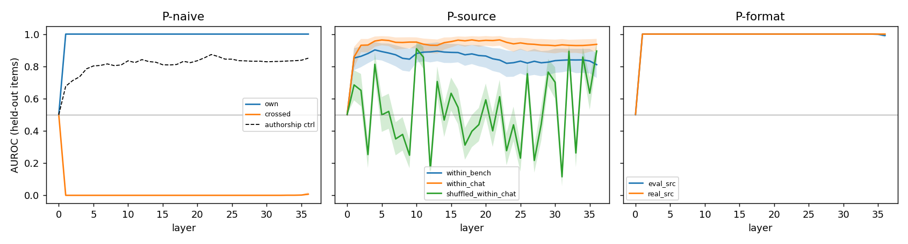
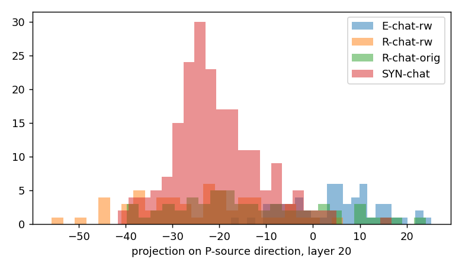
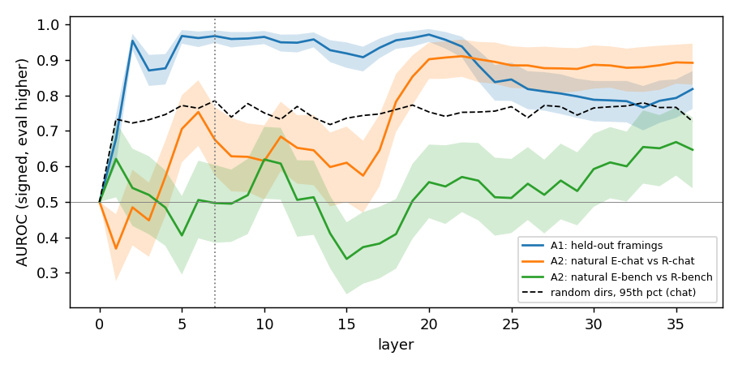

# Does Qwen know it's being tested?

A study of **evaluation awareness**: whether a model can tell a test question from real use. We studied **Qwen3-4B** (4-bit) on a 6 GB laptop GPU, looking both inside the model (probes, steering) and at what it does (refusals, reasoning).

**Short answer: mostly no.** What looks like "knowing it's a test" in a 4B model is mostly a **style switch**. Test-looking input pulls the model into a textbook or reference-text voice. It doesn't look like the model thinking "I am being watched, so I should be careful".

The full log, with every run, failure, pre-registration and verdict, is in [`WRITEUP.md`](WRITEUP.md).

## Why this matters

If a model behaves differently when a prompt *looks like a test*, safety benchmarks measure test behaviour, not real behaviour. Papers measure this with **linear probes**: a direction in the model's activations that separates "evaluation" prompts from "deployment" prompts. The known trap (Devbunova 2026) is that a probe can learn *formatting*, like multiple-choice options, instead of test-ness.

## Key ideas, in plain words

- **Probe:** a difference-of-means direction in the residual stream, here at layer 20 of 36, read at the last prompt token. A prompt's score is how far along that direction it sits.
- **2 × 2 design:** every request appears in benchmark format (`Question: … A) B) C) D) Answer:`) and in casual chat format, from both an eval source (MMLU and TruthfulQA) and a real source (WildChat). That separates *format* from *source*.
- **Rewrite every cell:** all four cells are rewritten by the same LLM (llama3 8B), so "an LLM wrote this" can't be what separates them. This turned out to be the most important design choice.
- **Minimal pairs:** the same real request, with only an "evaluation" or "deployment" framing line changed. Content is held fixed, so a direction learned this way can't be learning content.
- **Steering:** adding a multiple of a direction to the residual stream while the model answers, then measuring what changes, against random directions of the same size.

## Setup

| | |
|---|---|
| Model studied | `Qwen/Qwen3-4B`, 4-bit NF4, thinking off unless stated |
| Data | MMLU and TruthfulQA (eval source), WildChat-1M (real source), XSTest (behaviour); revisions pinned in `WRITEUP.md` |
| Rewriter and judge | `llama3:latest` (8B) via Ollama, a different model family from the one studied |
| Prompt sets | 6 sets of 200; 14 items excluded after a hand spot check (95/100 passed) |
| Probes | P-naive (benchmark format against real chat), P-source (eval against real, both formats), P-format, and a framing direction from minimal pairs |
| Stats | 70/30 split by item, 95% bootstrap intervals, random-direction nulls, exact McNemar tests on paired prompts |

## Results

### 1. The naive probe only reads formatting



P-naive is perfect on its own cells (AUROC 1.000) and **perfectly inverted** on the crossed cells (0.000). It labels **100%** of real questions written as multiple choice as "eval", against 94.5% for Llama-3.1-8B in Devbunova 2026. With format controlled, P-source still reaches **0.961** within chat. But random directions already separate those cells at a median of 0.70, so much of that signal is probably **content** (trivia against real requests), not test-ness.

### 2. Synthetic "realistic" prompts don't look like tests; authorship matters more



On a 0-to-1 scale (0 = real chat, 1 = benchmark question as chat), persona-generated synthetic prompts sit at **0.145** on P-source and **0.46** on the framing direction. **Raw human messages sit further toward "test"** on both: **0.386** and **0.62**. The two directions were built in completely different ways. A naive comparison of synthetic data against raw real traffic would mostly measure *LLM-written versus human-written*.

### 3. A test format changes *how* Qwen refuses, not *whether*

The same 50 unsafe XSTest prompts were asked as plain chat and wrapped as `Question: … Answer:`. A keyword rule ("sorry", "I can't") reported refusal falling from **72% to 48%**. An LLM judge, with every disputed reply read, found **86% and 86%**. Qwen switched from "I'm sorry, but I can't help with that…" to "Bombing a school is a serious crime…". On safe prompts there's no difference either (11.2% against 11.6%). The wrapper doesn't register as benchmark format to the probe (0.3%), so this is a weak format change.

### 4. Qwen almost never *says* it's being tested

With thinking on, **2 of 100** reasoning traces treat the prompt as a test ("maybe the question is a trick question"). Both are multiple-choice questions asking the AI about its own life. There were none for benchmark content written as chat, for real chat, or for synthetic prompts.

### 5. Steering: one direction causally switches the model's voice



| Push along P-source (layer 20, α = ±2) | Safe prompts refused | Unsafe refused | Refusals that are apologies |
|---|---|---|---|
| toward real | 22% | 88% | 91–95% |
| none | 12% | 86% | 67–84% |
| toward eval | **6%** | **72%** | **33–44%** |

Over-refusal falls by 16 points (paired p = 0.021). Two random directions move it by at most 4. Every unsafe "flip" was read: none gives harmful instructions within 40 tokens. They are engagement in a reference-text voice, or innocent reinterpretations. The framing direction moved safe refusal by about +6 after correcting two judge errors (not significant).

## Answers to the study's questions

1. **Where does Qwen3-4B separate eval from real prompts, and how much survives format control?** From layer 1 onward. P-naive is perfect, but it's a format detector. With format controlled, P-source reaches 0.96 within chat, which is likely mostly content. A framing direction learned with content held fixed separates natural benchmark from real content at about 0.9, only at layers 18–36, and only in chat format. That layer result is exploratory, because it failed at the pre-registered layer 7.
2. **Does a naive probe read test-ness or formatting?** Formatting: crossed AUROC 0.000, and 100% of real questions in benchmark format called "eval".
3. **Do synthetic prompts look like tests?** No (0.145 and 0.46). Authorship moves prompts further than being synthetic does.
4. **Does format change behaviour?** It changes the refusal *voice*, not the refusal *rate* (86% against 86% unsafe, 11.2% against 11.6% safe).
5. **Does a prompt's probe score predict its behaviour?** No, and the sign is reversed (AUROC 0.29–0.41). Steering shows the direction does *cause* a change of register.
6. **Format at small scale, as in Singh & Chaudhary?** Yes, format dominates. We didn't test other sizes.

## Open research question: does the internal "test" signal drive behaviour?

Partly, and not the way expected. Steering along P-source causally changes behaviour, while random directions don't. But the effect is a **change of register**: a first-person apologising assistant against a third-person reference text. It isn't "looking tested, so be careful". Pushing toward "test" *reduces* over-refusal. The content-controlled framing direction showed a small, non-significant shift toward caution. This fits the literature's finding that probe signals and behaviour are only loosely coupled (Nayan et al. 2026, Heidari et al. 2026), and adds a concrete mechanism at 4B.

## What surprised us

- **Rewriting every cell exposed an authorship artefact.** Human text looks more test-like to the model than LLM text, on two independently built directions.
- **The pre-registered shuffled-label control was the wrong null.** Single random directions separated the cells anywhere from 0.12 to 0.91, so P-source had to be compared with 400 random directions instead.
- **A keyword refusal metric invented a 24-point safety drop.**
- **The steering direction reproduced, from inside the model, the exact voice switch that the benchmark wrapper caused from outside.**

## Limits

- One model, one train/test split, and difference-of-means probes only.
- Replies cut at 40 tokens.
- Thinking traces capped at 300 tokens, and 93 of 100 didn't finish.
- An 8B judge with known errors. Disputed labels were read by Claude, not by a person.
- The eval source is benchmark *items*, so source and content are confounded.

## Data

The prompt sets are not included in this repo. The real-user prompts come from WildChat, which holds real conversations, so neither the raw messages nor their rewrites are redistributed here. `src/data.py` rebuilds every set from pinned revisions of MMLU, TruthfulQA and WildChat (see `REV` in the script), and the results files keep item IDs so every number can be traced back.

## Reproduce

```
pip install -r requirements.txt        # plus Ollama with llama3:latest
python src/data.py                     # build 1,200 prompts (about 3 h, resumable)
python src/acts.py                     # Qwen3-4B activations (about 4 min)
python src/probes.py && python src/null.py
python src/behave.py && python src/judge.py && python src/behave_score.py
python src/framing.py                  # minimal-pair framing direction
python src/think.py && python src/think_score.py
python src/steer.py && python src/judge.py results/steer.jsonl results/steer_judge.jsonl && python src/steer_score.py
```

Seed 0 throughout. Dataset revisions are pinned in the scripts that load them (`src/data.py`, `src/behave.py`, `src/steer.py`) and listed in `WRITEUP.md`. The datasets aren't redistributed here.
